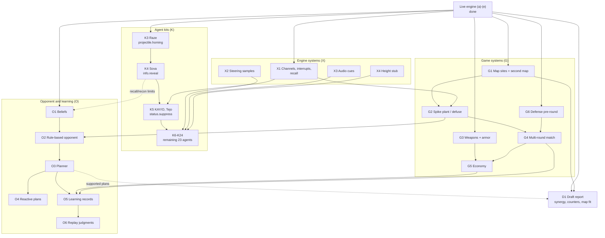

# Roadmap

Tag: **design**. Updated 20 November 2026.

This is the single list of every planned stage: what it delivers, how we intend to build it, the steps, and what it depends on. Detailed designs live in per-stage plan docs (linked where they exist). Write a stage's plan doc before implementing it, as with [`stage-1-plan.md`](stage-1-plan.md), [`stage-3-plan.md`](stage-3-plan.md) and [`stage-d-plan.md`](stage-d-plan.md).

Status today is in [`PROJECT_STATUS.md`](../PROJECT_STATUS.md).

Detailed plans written so far (wave 1 of planning, 20 November 2026): [G1](stage-g1-plan.md), [G2](stage-g2-plan.md), [G3](stage-g3-plan.md), [G4](stage-g4-plan.md), [G5](stage-g5-plan.md), [G6](stage-g6-plan.md), [O1](stage-o1-plan.md), [O2](stage-o2-plan.md), [X1](stage-x1-plan.md), [D1](stage-d1-plan.md), [K3](stage-3-plan.md), [K4](stage-k4-plan.md), [K5](stage-k5-plan.md). How to build them in parallel without conflicts: [`parallel-build-plan.md`](parallel-build-plan.md).
H0, the behaviour-neutral refactor that runs alone before wave 1: [`stage-h0-plan.md`](stage-h0-plan.md).

## Ground rules (apply to every stage)

- **Engine stays pure.** `src/sim`, `src/tactics`, `src/learning`, `src/persistence` and `src/rules` never import React. The architecture test enforces this.
- **Deterministic.** Integer ms and mm, the `(timeMs, sequence, agentId)` queue, named RNG streams, no `Math.random`. Same inputs give deep-equal outputs.
- **Every number is tagged** with its source (`verified`, `secondary`, `sheet`, `assumed`, `design`, `owner`). Missing numbers become named ASSUMED constants, never silent magic numbers.
- **One engine.** Everything builds on the live runner (`openLiveRound` / `issueOrders` / `stepLive`). The window layer is gone (Stage e).
- **Gate.** A stage is done only when `npm run check` passes, `PROJECT_STATUS.md` and `docs/playtest.md` are updated, and no test was deleted to go green.

## Done

| Stage | Delivered |
| --- | --- |
| Milestone 1 | Drill Hall map, catalog, Sky Smoke, both-team draft, coverage report, scenario JSON. |
| Milestone 2 | Interactive rounds, fog of war, defense hold stub, auto-engage, HP and death. |
| Kit stage 1 | Breach fully executable ([plan](stage-1-plan.md)). |
| Kit stage 2 | Brimstone fully executable. |
| Cast UI | Aim / map-target / charge casts, overlays, agent panel, event log. |
| Live (a)-(e) | Pauseable live engine, smooth motion, immediate orders, round timer, replay, fast controls and previews, pre-round buy/plan, window layer retired ([plan](live-round-plan.md), [migration](live-round-migration.md)). |

## Dependency graph

A solid arrow means "must be done first". A dotted arrow means "the later part of this stage needs it"; the stage can start without it.

## Recommended order

1. **K3 Raze.** Fully designed already, and it builds the first homing projectile on the live engine.
2. **X1 Channels and G1 Map sites.** Both unblock the spike.
3. **G2 Spike plant / defuse.** Gives rounds a real objective, so attack and defense play differently.
4. **O1 Beliefs, then O2 Rule-based opponent.** Replaces the hold stub, so the game is playable against something.
5. **G6 Defense pre-round, G4 Multi-round match, G3 Weapons + armor, G5 Economy.** Turns single rounds into a match.
6. **K4 onwards, D1, O3-O6** in dependency order, with kit stages slotted between system stages.

The owner can reorder anything that the graph allows.

---

## K: Agent kit stages

Agents are completed in the order of `data/primitive-stages.json`. Each stage adds the effect primitives that its agents are the first to need, so stage *N* depends on every primitive from stages before it. The primitive list and per-ability mapping are in [`effect-primitives.md`](effect-primitives.md).

### Steps for every kit stage

1. **Plan doc** `docs/stage-N-plan.md`: primitives, every ability number with its tag, gaps that need ASSUMED constants, open questions (max 6) for the owner.
2. **Primitives.** Add the new job types and state to `src/sim/run.ts`, `src/sim/effects/` and `src/sim/types.ts`, each with pure `apply*` functions and unit tests.
3. **Ability definitions** in `src/sim/agents/abilities/<agent>.ts` with sheet provenance, plus a `<agent>-resolve.ts` for cast and follow-up jobs.
4. **Catalog.** Register the agent and set each ability to `implementation: "complete"` only when its resolve path exists.
5. **Live validation.** Make sure `validateCommand` in `live-round.ts` covers ownership, charges, cooldown and ult for the new casts.
6. **Fog.** Decide what the enemy sees in `viewLive` (devices, zones, reveals).
7. **UI.** Cast kind and preview in `src/ui/orders/abilityUi.ts` and `src/ui/board/previews.ts`, plus the overlay in `MapView.tsx`.
8. **Tests** in `tests/sim/<agent>.test.ts` on the live harness: catalog drift against `agent-reference.json`, ownership, charges, ult gate, timing, geometry, fog, and a same-seed deep-equal.
9. **Docs.** Update `PROJECT_STATUS.md`, `docs/playtest.md` and the default drill if the agent should be playable.

**Done when** every slot and the passive are `complete` and covered by tests (owner decision 9 in `effect-primitives.md`).

### Stage list

| Stage | New primitives | Agents completed | Also needs | Notes |
| --- | --- | --- | --- | --- |
| K3 | `projectile.homing` | Raze | live engine | Fully planned in [`stage-3-plan.md`](stage-3-plan.md). Adds the falloff helper and kill-based signature recharge. |
| K4 | `info.reveal` | Sova | K3 | Reveals feed fog; this is also the first input for O1 beliefs. |
| K5 | `status.suppress` | KAY/O, Tejo | K4, X1 | Suppress must cancel channels and block casts, so X1 comes first. KAY/O is a placeholder in the catalog today. |
| K6 | `status.slow`, `trigger.zone` | Deadlock, Vyse | K5 | Trip-wire style zones fire jobs when entered. |
| K7 | `movement.teleport` | Chamber | K6 | Teleport anchors are devices; needs recall from X1. |
| K8 | `status.nearsight` | Harbor | K7 | Vision-limiting status, applied in `viewLive`. |
| K9 | `support.heal` | Skye | K8 | Ally-target orders (new command field). |
| K10 | `support.revive` | Phoenix, Sage | K9 | Revive brings back a downed body; needs dead-body state. |
| K11 | `status.decay`, `status.overheal` | Clove | K10 | Temporary max-HP rules. |
| K12 | `info.audioOrMinimap`, `status.snapshot` | Cypher | K11, X3 | Cypher is a placeholder in the catalog today. |
| K13 | `status.deafen` | Miks, Omen | K12, X3 | Deafen hides audio cues. |
| K14 | `status.tether` | Veto | K13 | |
| K15 | `movement.pull` | Fade | K14 | |
| K16 | `resource.passiveMeter`, `status.vulnerable` | Astra, Viper | K15 | Controller role fully complete after this stage. |
| K17 | `status.detain` | Gekko, Killjoy | K16 | Initiator and sentinel roles fully complete. |
| K18 | `support.shield` | Iso | K17 | |
| K19 | `movement.dash` | Neon | K18 | |
| K20 | `movement.glide` | Jett | K19, X4 | Jett is a placeholder in the catalog today. |
| K21 | `status.intangible` | Reyna | K20 | Auto-fire must skip intangible targets. |
| K22 | `status.hinder` | Waylay | K21 | |
| K23 | `projectile.steerable` | Yoru | K22, X2 | |
| K24 | `interact.pickup`, `status.levitate` | Hush | K23, X2, X4 | Duelist role fully complete; all 30 agents done. |

## X: Engine systems for later kits

These came from the turn-layer notes in `effect-primitives.md` section 5 and are now planned against the live runner. Build each one just before the first kit stage that needs it.

| Stage | Delivers | Approach and steps | Depends on | Needed by |
| --- | --- | --- | --- | --- |
| X1 Channels, interrupts, recall | Windups and channels that can be cancelled; a player `recall` command for reclaimable devices. | Add `channel-start` / `channel-complete` jobs; cancel them on caster death, suppress or detain, with a typed cancel event; add a `recall` `AgentCommand` validated like `cast`; use refund rules only where the source states them. | live engine | G2, K5, K7, K12, K17 |
| X2 Steering samples | Crosshair-steered abilities without continuous mouse input. | Cast carries up to 4 aim samples at fixed offsets (owner decision 1); samples go in the order log so replays match. | live engine | K23, K24 |
| X3 Audio cues | Sounds without breaking fog. | `viewLive` returns optional `audioCues[]` for the viewing side only (owner decision 3); deafen hides them. | live engine | K12, K13 |
| X4 Height stub | Vertical movement on a 2D map. | Timing-only stubs for updraft, glide and levitate; no height layer (owner decision 2). | live engine | K20, K24 |

## G: Game systems

### G1 Map sites and a second map

- **Delivers:** plant sites, spawn zones and named callout regions on Drill Hall, then a second original map.
- **Approach:** extend the map type in `src/sim/map/` with polygons for sites and regions; keep maps original (no game assets).
- **Steps:** (1) add region types and a point-in-polygon helper with tests; (2) mark sites on Drill Hall; (3) draw regions in `MapView`; (4) design the second map with at least two sites; (5) add a map picker to the draft.
- **Depends on:** live engine. **Unblocks:** G2, D1 map fit, ult-orb placement.

### G2 Spike plant and defuse

- **Delivers:** a spike carrier, plant and defuse actions, post-plant timer, new round results.
- **Approach:** plant and defuse are X1 channels (`{ kind: "plant" }` and `{ kind: "defuse" }` in X1's `ChannelWhat`), so death and movement cancel them. Timers come from a primary source if one exists, otherwise they are tagged ASSUMED.
- **Steps:** (1) add spike state (carrier, dropped position, planted site, timer) to the world; (2) add `plant` / `defuse` commands and validation (on site, alive, not moving); (3) add `spike-detonated` and `spike-defused` to `RoundResult`, and switch the round timer to the spike timer on plant; (4) add plant/defuse ult points to the ledger (TODO today); (5) add the UI: carrier marker, plant button, timer; (6) tests for each result path and determinism.
- **Depends on:** G1, X1. **Unblocks:** G4, O2.

### G3 Weapons and armor

- **Delivers:** a versioned weapon table and armor tiers, replacing Rifle A only where a primary source exists.
- **Approach:** fill the `loadoutFuture` extension point that is already on `PreRoundPlan`; weapon stats sit in `src/sim/combat/` with provenance per field; hit chance keeps its existing basis-point model unless a source says otherwise.
- **Steps:** (1) weapon and armor types with provenance; (2) damage model that applies armor; (3) buy lines for weapons/armor in the pre-round validator; (4) shop UI in the pre-round screen; (5) tests (damage, armor, buy rejections).
- **Depends on:** live engine. **Unblocks:** G5.

### G4 Multi-round match

- **Delivers:** a match of rounds with halves, side switch and overtime.
- **Approach:** a pure `Match` wrapper that holds a list of finished `LiveRound` results and builds the next round's scenario; each round still opens through pre-round.
- **Steps:** (1) match state and score; (2) next-round scenario builder (survivor carry-over rules stay out until sourced); (3) side switch at the half and overtime rules, tagged; (4) match replay file version; (5) scoreboard UI; (6) tests.
- **Depends on:** G2 (real round outcomes), G6 (both sides plan). **Unblocks:** G5, O5.

### G5 Economy

- **Delivers:** credits from wins, losses and kills; ability purchases between rounds; signature replenish.
- **Approach:** a pure economy step run between rounds by G4; all amounts tagged.
- **Steps:** (1) round-end credit rules; (2) carry credits and charges into the next round; (3) signature replenish rules per agent; (4) show economy in the pre-round screen; (5) tests.
- **Depends on:** G3, G4. **Unblocks:** O5 (economy band).

### G6 Defense pre-round

- **Delivers:** a pre-round plan for defense as well as attack.
- **Approach:** `PreRoundPlan.side` already exists; allow `"defense"` and let either a player or the opponent fill it.
- **Steps:** (1) validator and `startLiveFromPreRound` accept both sides; (2) replay v2 carries both plans; (3) UI side toggle for hot-seat play; (4) tests.
- **Depends on:** live engine. **Unblocks:** G4, O2.

## O: Opponent and learning

### O1 Beliefs

- **Delivers:** what a side believes about the enemy, built only from fogged views.
- **Approach:** fill `DecisionContext` in `src/tactics/decision.ts` from `viewLive`; last-seen positions decay over time; smokes limit sight now, and reveals and trips limit it as those kits land.
- **Steps:** (1) belief state type and update function; (2) wire it into the decide hook in `stepLive`; (3) tests proving truth never leaks into a belief.
- **Depends on:** live engine (K4 for recon). **Unblocks:** O2.

### O2 Rule-based opponent

- **Delivers:** a defense that holds angles, rotates to the spike and uses utility, with Beginner and Intermediate presets.
- **Approach:** ordinary TypeScript rules over beliefs (no machine learning), issued through `issueOrders` at the decision cadence so every choice is in the order log.
- **Steps:** (1) hold-angle and rotate rules; (2) utility use from the catalog (when a smoke or flash is useful); (3) presets as parameter sets; (4) tests for determinism and fog-only inputs; (5) difficulty picker in the UI.
- **Depends on:** O1, G2, G6. **Unblocks:** O3.

### O3 Planner

- **Delivers:** plans whose steps name the agent, resources, timing, dependencies and fallbacks.
- **Approach:** a plan is a list of steps that compile down to `PreRoundPlan` plus live triggers; the same format serves the player (suggestions) and the opponent.
- **Steps:** (1) plan step types; (2) a compiler to orders and plan steps; (3) a feasibility check against the current draft and resources; (4) UI to pick and preview a plan; (5) tests.
- **Depends on:** O2. **Unblocks:** O4, O5, D1 supported plans.

### O4 Reactive plans

- **Delivers:** plans that change with the draft, deaths and spent utility during a round.
- **Approach:** re-run the O3 feasibility check at the decision cadence and switch to the step's fallback when a dependency fails.
- **Depends on:** O3.

### O5 Learning records

- **Delivers:** stored outcomes keyed by agent, sequence, map, side, economy band and both composition ids.
- **Approach:** fill the existing contracts in `src/learning/record.ts`; records are versioned JSON; the Radiant and VCT presets read the same store under the same rules.
- **Depends on:** O3, G4, G5. **Unblocks:** O6.

### O6 Replay judgments and batch comparison

- **Delivers:** a verdict on each replay (what went well or badly) and side-by-side comparison of many seeded runs.
- **Approach:** run batches headless through `replayOrderLog` with different seeds, then compare outcomes using learning records.
- **Depends on:** O5.

## D1: Richer draft report

- **Delivers:** map fit, synergies, counter-composition and which plans a composition can support, alongside the existing coverage report.
- **Approach:** add evaluators to the `PLANNED_EVALUATORS` list in `src/sim/composition/`; each one reports suitability only, never a win prediction.
- **Steps:** (1) synergy and counter-composition from catalog tags (can start now); (2) map fit once G1 exists; (3) supported plans once O3 exists; (4) report UI in the draft panel.
- **Depends on:** live engine; G1 and O3 for the later parts.

## Out of scope for now

Machine learning runtime, a backend or online play, IndexedDB, real game assets (maps, art, audio), and any number with no source that is not tagged ASSUMED.
